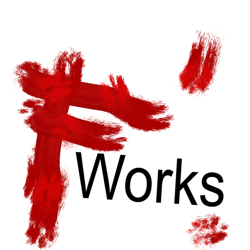

<div align="center">



# F Works

The site of a one-person project. Programs you launch yourself, and tools that extend other people's work.

[](LICENSE)

[Русский](README.md) · Site: `fworks.github.io`

</div>

---

## How it works

Static, with no bundler: HTML, one shared `style.css`, and **no JavaScript on the pages**.

Every page exists in four files — Russian and English, dark and light:

```
index.html            Russian, dark
index.light.html      Russian, light
index.en.html         English, dark
index.en.light.html   English, light
```

The theme is the file name rather than state kept in the browser. The switch is therefore
an ordinary link, the choice is stored nowhere, and a page cannot "remember" someone
else's theme. Sections with no light version — Codex, the skill and Noise Dream — exist
only in dark.

## Editing the text

Edit the **dark** file, then rebuild:

```bash
node tools/variants.mjs
```

`index.html` produces all four variants. Light versions are not edited by hand — the
build overwrites them. The year in the footer is substituted at build time, so the line
never goes stale on its own.

To check that every link points where it should:

```bash
node tools/verify-variants.mjs
```

## Local preview

```bash
node tools/serve.mjs
```

It will listen on `http://127.0.0.1:8099`. The server returns `404.html` for unknown
paths, the same way GitHub Pages does.

## License

The site is under [CC BY-NC-ND 4.0](LICENSE): you may read and use it, but not modify it
or use it commercially. The text is the official one, unaltered.

The products are licensed separately: [Codex](https://github.com/fworks/Codex-dnd-character-sheets)
under Apache-2.0, the [build-with-me](https://github.com/fworks/build-with-me) skill under CC BY-NC-ND 4.0.
